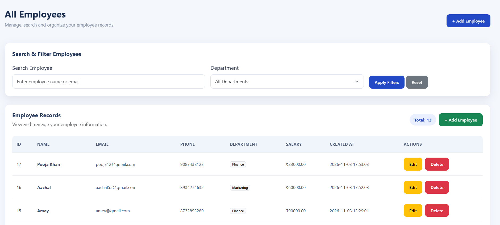
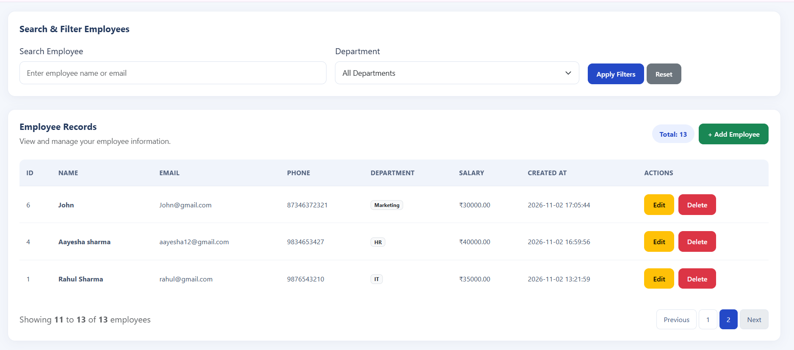
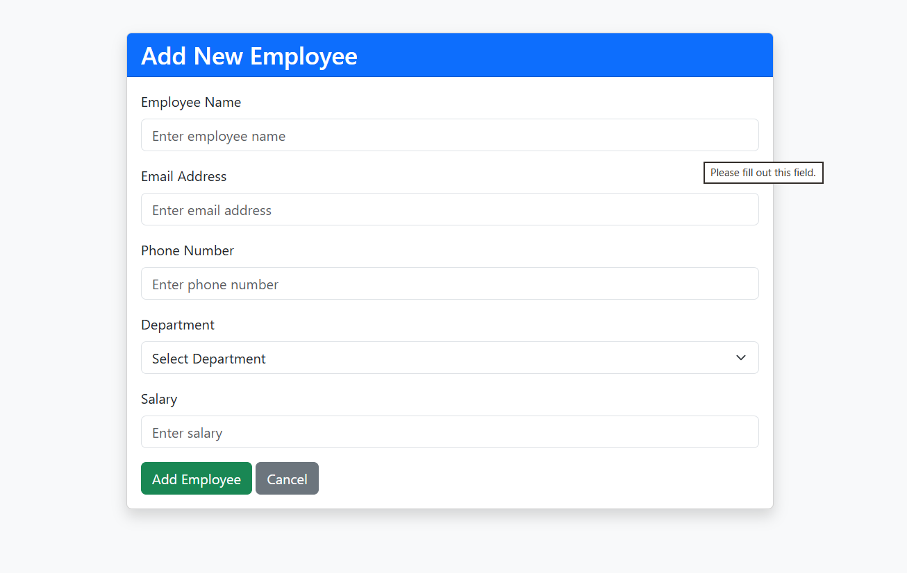
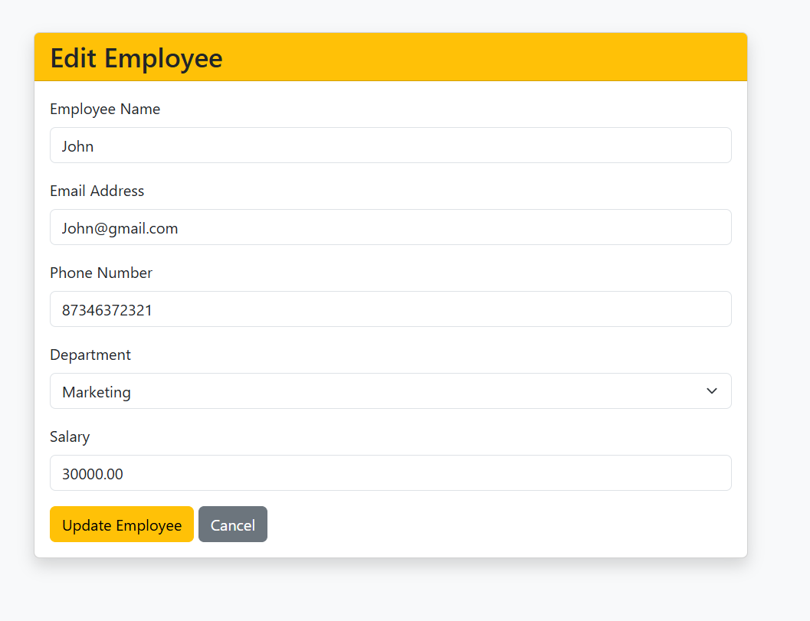
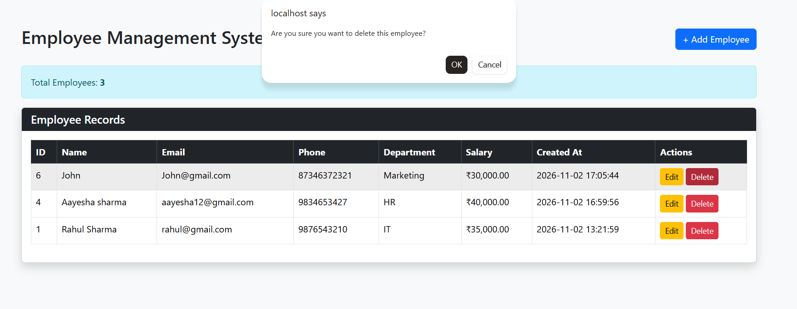
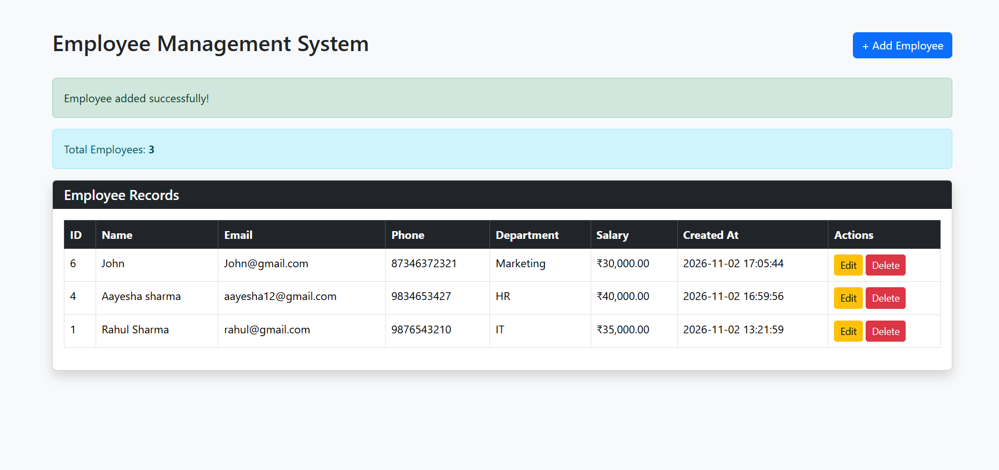

# Employee Management System – PHP CRUD

A responsive Employee Management System developed using PHP, PDO, MySQL, Bootstrap 5, HTML, CSS, and JavaScript.

This project allows users to manage employee records through CRUD operations, search employees, filter by department, and navigate records using pagination.

## Features

### Employee Management (CRUD)
- Add new employee records.
- View all employee records.
- Update existing employee details.
- Delete employee records with a confirmation prompt.
- Validate employee form inputs.
- Prevent duplicate email addresses.

### Search and Filtering
- Search employees by name.
- Search employees by email address.
- Filter employees by department.
- Combine search and department filters.
- Reset filters to display all employees.

### Pagination
- Display 10 employee records per page.
- Navigate between pages using Previous and Next.
- Maintain selected search and department filters while navigating.
- Display an appropriate message when no matching records are found.

### UI and User Experience
- Responsive dashboard design.
- Bootstrap 5 styling.
- Custom CSS styling.
- Smooth entrance animations and hover effects.
- Responsive employee table with horizontal scrolling on smaller screens.
- User-friendly forms and action buttons.

### Security
- PDO prepared statements for database operations.
- CSRF token protection for delete requests.
- Server-side form validation.
- HTML output escaping to reduce XSS risks.

## Technologies Used

| Technology | Purpose |
|---|---|
| PHP | Backend development |
| MySQL | Database |
| PDO | Database connectivity |
| HTML5 | Page structure |
| CSS3 | Styling and animations |
| Bootstrap 5 | Responsive UI |
| JavaScript | Client-side interactions |
| XAMPP | Local development environment |
| Git & GitHub | Version control |

## Project Structure

```text
php-crud/
│
├── assets/
│   └── css/
│       └── style.css
│
├── config/
│   └── database.php
│
├── models/
│   └── Employee.php
│
├── screenshots/
│   ├── dashboard.png
│   ├── add-employee.png
│   ├── edit-employee.png
│   └── delete-confirmation.png
│
├── index.php
├── create.php
├── edit.php
├── delete.php
├── .gitignore
└── README.md
```
## Screenshots

### 1. Employee Dashboard – Overview


### 2. Employee Dashboard – Search and Filtering


### 3. Add Employee


### 4. Edit Employee


### 5. Delete Confirmation


## Requirements

- PHP 8.0 or later
- MySQL
- XAMPP
- Web browser
- Git (optional, for version control)

## Installation and Setup

### 1. Clone the Repository

```bash
git clone https://github.com/varshabombe10/php-crud.git
```

### 2. Move the Project into XAMPP

Place the project folder inside:

```text
C:\xampp\htdocs\
```

### 3. Start XAMPP

Open the XAMPP Control Panel and start:

- Apache
- MySQL

### 4. Create the Database

Open phpMyAdmin:

```text
http://localhost/phpmyadmin/
```

Create a database named:

```sql
php_crud
```

Select the database and execute:

```sql
CREATE TABLE employees (
    id INT AUTO_INCREMENT PRIMARY KEY,
    name VARCHAR(100) NOT NULL,
    email VARCHAR(150) NOT NULL UNIQUE,
    phone VARCHAR(15) NOT NULL,
    department VARCHAR(100) NOT NULL,
    salary DECIMAL(10,2) NOT NULL,
    created_at TIMESTAMP DEFAULT CURRENT_TIMESTAMP
);
```

### 5. Configure Database Connection

Open:

```text
config/database.php
```

Configure the connection according to your local MySQL settings.

Example XAMPP configuration:

- Host: `127.0.0.1`
- Port: `3307` (change according to your MySQL configuration)
- Database: `php_crud`
- Username: `root`
- Password: Your local MySQL password

Do not upload database passwords or private credentials to GitHub.

### 6. Run the Application

Open your browser and visit:

```text
http://localhost/php-crud/
```

## Database Operations

The application uses the Employee model to handle database operations.

| Method | Description |
|---|---|
| `create()` | Adds an employee |
| `readAll()` | Retrieves all employees |
| `getById()` | Retrieves an employee by ID |
| `update()` | Updates employee details |
| `delete()` | Deletes an employee |
| `getDepartments()` | Retrieves department names |
| `getFilteredEmployees()` | Handles search, filtering and pagination |
| `countFilteredEmployees()` | Counts matching employee records |

## Learning Outcomes

- Understanding PHP fundamentals.
- Connecting PHP applications to MySQL using PDO.
- Implementing CRUD operations.
- Using prepared statements for database queries.
- Implementing search and department filtering.
- Implementing pagination.
- Maintaining filters across pagination.
- Building responsive interfaces using Bootstrap.
- Adding CSS animations and hover effects.
- Organizing application code using a model-based structure.
- Managing project versions using Git and GitHub.

## Author

**Varsha Bombe**

GitHub: https://github.com/varshabombe10

## Project Repository

https://github.com/varshabombe10/php-crud


<!-- # Employee Management System – PHP CRUD

A simple Employee Management System built using PHP, PDO, MySQL, and Bootstrap. This project demonstrates all four CRUD operations: Create, Read, Update, and Delete.

## Features

- Add new employee records.
- View all employees in a dashboard.
- Update existing employee details.
- Delete employee records with a confirmation prompt.
- Validate form inputs.
- Prevent duplicate email addresses.
- Use PDO prepared statements for database operations.
- Use CSRF tokens to protect delete requests.
- Responsive interface using Bootstrap.

## Technologies Used

- **Backend:** PHP
- **Database:** MySQL
- **Database Connectivity:** PDO
- **Frontend:** HTML, CSS, Bootstrap
- **Development Environment:** XAMPP
- **Version Control:** Git and GitHub

## Project Structure

```text
php-crud/
│
├── config/
│   └── database.php
│
├── models/
│   └── Employee.php
│
├── assets/
│   └── css/
│
├── index.php
├── create.php
├── edit.php
├── delete.php
├── .gitignore
└── README.md
```

## Requirements

- PHP 8.0 or later
- MySQL
- XAMPP
- Web browser

## Installation and Setup

### 1. Clone the repository

```bash
git clone https://github.com/YOUR_USERNAME/php-crud.git
```

### 2. Move the project into XAMPP

Place the project folder inside:

```text
C:\xampp\htdocs\
```

### 3. Start XAMPP

Start Apache and MySQL from the XAMPP Control Panel.

### 4. Create the database

Open phpMyAdmin:

```text
http://localhost/phpmyadmin/
```

Create a database named:

```sql
php_crud
```

Select the database and execute:

```sql
CREATE TABLE employees (
    id INT AUTO_INCREMENT PRIMARY KEY,
    name VARCHAR(100) NOT NULL,
    email VARCHAR(150) NOT NULL UNIQUE,
    phone VARCHAR(15) NOT NULL,
    department VARCHAR(100) NOT NULL,
    salary DECIMAL(10,2) NOT NULL,
    created_at TIMESTAMP DEFAULT CURRENT_TIMESTAMP
);
```

### 5. Configure the database connection

Open:

```text
config/database.php
```

Set the database host, port, name, username, and password to match your local MySQL configuration.

Example local XAMPP settings:

- Host: `127.0.0.1`
- Port: `3307` (change if your MySQL uses a different port)
- Database: `php_crud`
- Username: `root`
- Password: your local MySQL password

Do not use development credentials in a public production deployment.

### 6. Run the project

Open your browser and visit:

```text
http://localhost/php-crud/
```

## CRUD Operations

| Operation | Description |
|---|---|
| Create | Add a new employee |
| Read | Display employee records |
| Update | Modify employee information |
| Delete | Remove an employee after confirmation |

## Application Screenshots

### 1. Employee Dashboard


### 2. Add Employee


### 3. Edit Employee


### 4. Delete Confirmation


## Learning Outcomes

- Understanding PHP fundamentals.
- Connecting PHP applications to MySQL using PDO.
- Writing SQL queries for CRUD operations.
- Using prepared statements.
- Implementing form validation.
- Organizing code using a simple model-based structure.
- Using Bootstrap to build responsive interfaces.
- Using Git and GitHub for version control.


## Author

**Varsha Bombe**

GitHub: https://github.com/varshabombe10 -->